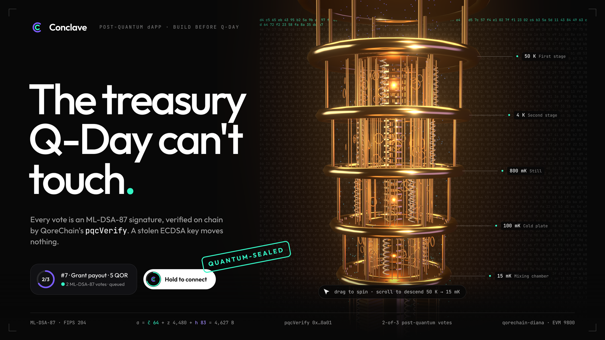
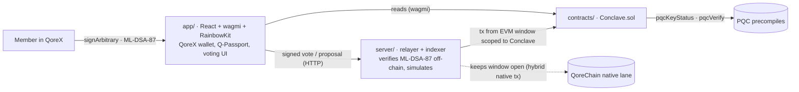

# Conclave

**A DAO treasury that only moves on post-quantum votes.**



Built for the **Post-Quantum dApp** bounty of *Build Before Q-Day: the QoreChain Developer Fest*.

[](https://build.qorechain.io/p/conclave)
[](https://github.com/Chijulybuilds/Quantum-dApp/actions/workflows/ci.yml)

---

## The problem

Every DAO today trusts one thing: the ECDSA keys of its members. A large quantum computer can
recover an ECDSA private key from its public key, and every member who has ever sent a transaction
has published theirs. On Q-Day an attacker can vote as any member, pass any proposal and empty the
treasury.

## What Conclave does

Every action that can move money or change who is in charge needs an **ML-DSA-87** (FIPS 204)
signature. The contract checks it with QoreChain's **`pqcVerify`** precompile, against the key each
member registered on chain (read with **`pqcKeyStatus`**, never supplied by the caller).

| Action | Who can do it | Authorised by |
|---|---|---|
| Propose a payout or rule change | A member | ML-DSA-87 signature |
| Vote for / against | A member | ML-DSA-87 signature |
| Cancel a proposal | Its proposer | ML-DSA-87 signature |
| Execute a passed proposal | Anyone, after the timelock | The proposal's majority of PQ votes |
| Add/remove members, change threshold or guardian, unpause, pay tokens | The DAO itself | An executed proposal |
| Pause payouts **once**, for at most `pauseDuration` | The guardian | Classical key (the only one) |
| Upgrade the contract's implementation | The DAO itself | An executed proposal (it owns its ProxyAdmin) |

Members sign in **QoreX** without paying gas, and the wallet shows them a plain-text message such as:

```text
Conclave v1
action: vote
support: for
proposal: 7
proposal hash: 0x9a1f…
member: 0xabcd…
dao: 0x5fbd…
chain: 9800
```

A **relayer** submits the signatures from an **EVM window scoped to the Conclave contract**. A
leaked relayer key can only submit signatures members already made, and only to Conclave.

**The worst a stolen classical key can do is one temporary pause.** It can never vote, approve,
withdraw or unpause, and a queued payout survives the pause because the grace period is longer.

**Upgradeable, without an upgrade key.** Conclave runs behind an OpenZeppelin
`TransparentUpgradeableProxy`, so its logic can be improved later at the same address, with the
same treasury and history. The proxy's `ProxyAdmin` is owned by Conclave itself: an upgrade is a
proposal like any other, needing the post-quantum majority and the timelock, and blocked while
paused. There is no classical key that could swap the code. See [Upgrading](#upgrading).

## The full stack



| Layer | What it does |
|---|---|
| [`contracts/`](contracts) | `Conclave.sol`: PQ-signed propose/vote/cancel, timelocked execution, guardian fuse |
| [`server/`](server) | Relayer and indexer (Hono): checks every ML-DSA-87 signature against the signer's on-chain key **before** spending gas, simulates, submits from an EVM window scoped to Conclave, re-opens that window when it runs low, indexes proposals, votes and activity |
| [`app/`](app) | Web app (Vite, React, wagmi, RainbowKit with the QoreX wallet, React Three Fiber, GSAP, Motion): a 3D dilution refrigerator that turns as you scroll down its five temperature stages while a **real ML-DSA-87 signature is computed in the browser** and revealed part by part (c̃ ‖ z ‖ h = 4,627 B); hold-to-connect "airlock"; Q-Passport; treasury dashboard, proposals, voting, execution |

**Why a relayer:** QoreX connects to dApps over EIP-6963, but it cannot send EVM transactions or
`personal_sign` yet. Conclave doesn't need either: members sign a readable message with
`window.qorex.native.signArbitrary` (ML-DSA-87), and the relayer submits it. Members need no gas
and no EVM window. The relayer adds no trust: the contract re-checks every signature, and the
relayer's own window can only reach Conclave. Wallets that can send EVM transactions (MetaMask with
an open window) can also execute directly through wagmi.

## Bounty requirements

| Requirement | Where | Status |
|---|---|---|
| **pqcVerify** | [`QorePQC.sol`](contracts/src/libraries/QorePQC.sol) `verify`/`accepts`, used by `propose`, `castVote(s)`, `cancel` in [`Conclave.sol`](contracts/src/Conclave.sol) | Done. Checked against the live precompile (see below) |
| **pqcKeyStatus** | [`QorePQC.sol`](contracts/src/libraries/QorePQC.sol) `keyOf`: signer keys and new members | Done. Checked against the live precompile |
| **Scoped EVM window** | [`scripts/window.ts`](contracts/scripts/window.ts) `open-scoped`: relayer window limited to the Conclave address | Done. Testnet evidence: [docs/EVIDENCE.md](docs/EVIDENCE.md) |
| **Two-stage QCAI audit** | [docs/AUDIT.md](docs/AUDIT.md), reports in [docs/audit/](docs/audit/) | Workbook ready; stages 1 and 2 to run |
| **Foundry tests** | [`contracts/test/`](contracts/test), [`contracts/test-ffi/`](contracts/test-ffi) | 146 unit, fuzz and invariant tests + 4 differential tests |

## Verified on the live testnet

`npm run pqc:check` runs these read-only checks on `qorechain-diana` (no funds needed):

```text
PASS  pqcVerify precompile active
PASS  pqcKeyStatus precompile active
PASS  pqcVerify accepts the QoreX signing bytes
PASS  pqcVerify rejects a changed message
PASS  pqcVerify rejects the bare message (no qorechain-msg-v1 prefix)
PASS  pqcVerify rejects another key
PASS  QorePQC.accepts (Solidity) accepts a valid signature on chain
PASS  QorePQC.accepts (Solidity) rejects a changed message on chain
PASS  QorePQC.keyOf (Solidity) decodes the registered key on chain
PASS  ConclaveProxy deploys with a ProxyAdmin owned by the proxy (as Conclave's is)
PASS  pqcVerify behind ConclaveProxy (DELEGATECALL): valid signature accepted
PASS  pqcVerify behind ConclaveProxy (DELEGATECALL): changed message rejected
PASS  pqcKeyStatus behind ConclaveProxy, in its constructor's init call and after
```

The last seven run Conclave's own Solidity code against the real precompiles, directly and behind a
real `ConclaveProxy` (the `DELEGATECALL` frames Conclave runs in), inside an `eth_call` of creation
code ([`script/LivePqcProbe.sol`](contracts/script/LivePqcProbe.sol),
[`script/LiveProxyProbe.sol`](contracts/script/LiveProxyProbe.sol)).

## Testing

| Suite | What it proves |
|---|---|
| `Conclave.Deploy` | Initializer validation through the proxy: members, keys, majority threshold, timing, chain id |
| `Conclave.Upgrade` | Only an executed proposal upgrades (fuzzed callers); state survives; blocked while paused; no re-initialization; ERC-7201 layout pinned; the DAO can freeze upgrades |
| `Conclave.Proposals` | PQ-signed proposals and cancellation; nonce, deadline, content binding |
| `Conclave.Voting` | Vote binding to proposal, support, member, DAO, EVM chain and native chain; key rotation and revocation; batch relay |
| `Conclave.Execution` | Timelock, grace period, content hash, all-or-nothing actions, revert bubbling, re-entrancy |
| `Conclave.Governance` | Self-only governance, membership and threshold changes, stale proposals |
| `Conclave.Pause` | One-shot guardian fuse, what a pause blocks and allows, pause shorter than grace |
| `Conclave.QDay` | An attacker holding **every** classical key cannot move funds, vote or replay signatures |
| `QorePQC` | The precompile wrappers fail closed on every unexpected answer |
| `ConclaveMessages` | Golden tests of the exact text members sign |
| `invariant/` | 256 runs × 64 random honest and attacker calls: treasury accounting, attacker never paid, no forged success, majority always valid |
| `test-ffi/` | The bytes the contract verifies are exactly what **QoreSign** (the library QoreX uses) signs; a real ML-DSA-87 signature verifies over them |

Coverage: 100% of functions, about 95% of lines and 93% of branches. The relayer has its own tests
(`server/test/`): real ML-DSA-87 signatures accepted and rejected the same way the contract does,
and request validation.

```bash
cd contracts
forge build --sizes   # Conclave: 17.5 KB of 24 KB (implementation), ConclaveProxy 1.0 KB
forge test            # unit + fuzz + invariant
npm ci && npm run test:ffi
```

Gas (contract cost measured with Foundry, plus the live `pqcVerify` cost measured on testnet):

| Call | Gas |
|---|---|
| `castVote` | ≈ 146k contract + ≈ 74k signature calldata + ≈ 185k `pqcVerify` precompile ≈ **400k** |
| `execute` (native payout) | ≈ 78k |

## Run it

Needs Node.js 20.19 or newer (`node -v`). Foundry is only needed to build and test the contracts.

```bash
npm run install:all     # installs root, server, app and contract-script dependencies
npm run keys            # creates server/.env (testnet recovery phrase) and prints the relayer address
# claim at least 2.5 test QOR for the relayer at https://dashboard.qorechain.io/faucet
npm run setup:testnet   # registers keys, funds demo accounts, deploys Conclave, opens the scoped window
npm run dev             # relayer on http://localhost:8787 + app on http://localhost:5173
```

Contracts on their own: `cd contracts && forge build && forge test`.

### Deploy to Vercel

The repository deploys to Vercel as one project: the app as static files and the relayer as a
Node.js function at `/api`, on the same domain. Import the repository, add `CONCLAVE_MNEMONIC`,
`CONCLAVE_ADDRESS` and `CONCLAVE_DEPLOY_BLOCK`, and deploy. Step by step:
[docs/DEPLOY.md](docs/DEPLOY.md).

[](https://vercel.com/new/clone?repository-url=https%3A%2F%2Fgithub.com%2FChijulybuilds%2FQuantum-dApp&env=CONCLAVE_MNEMONIC,CONCLAVE_ADDRESS,CONCLAVE_DEPLOY_BLOCK&envDescription=Relayer%20recovery%20phrase%20(testnet%20only)%20and%20the%20deployed%20Conclave&envLink=https%3A%2F%2Fgithub.com%2FChijulybuilds%2FQuantum-dApp%2Fblob%2Fmain%2Fdocs%2FDEPLOY.md&project-name=conclave)

The app can also be published alone to GitHub Pages by [`pages.yml`](.github/workflows/pages.yml)
(set the repository variable `CONCLAVE_API_URL` to the public relayer URL). QoreX mobile needs a
public HTTPS address, so test the mobile wallet on the published app.

`forge script` cannot deploy Conclave: Foundry's local EVM has no QoreChain precompiles, so the
initializer's key checks would fail in simulation. `server/src/setup.ts` and
`contracts/scripts/deploy.ts` send the deployment straight to the chain instead.

### Replacing a lost member

If a member loses their account, the others vote it out and a new one in, like any proposal. On
the testnet DAO the two demo members hold a majority, so one command does it from the relayer
machine (the new account needs a registered ML-DSA-87 key):

```bash
npm run replace-member -- <new 0x|qor1> [old 0x|qor1] --dry-run   # check first
npm run replace-member -- <new 0x|qor1> [old 0x|qor1]             # propose, vote, wait, execute
```

`old` defaults to `CONCLAVE_FOUNDER`. The DAO keeps its address, treasury and history.

## Upgrading

Conclave is deployed as an implementation behind `ConclaveProxy` (an unmodified OpenZeppelin 5.7
`TransparentUpgradeableProxy`). Everyone uses the proxy address; it never changes. To ship a new
version:

1. Write it as a contract that keeps `Conclave`'s storage (one ERC-7201 namespace: only append
   fields) and bumps `version()`. A one-time migration goes in a `reinitializer(n)` function, not
   marked `nonReentrant` (it runs inside `execute`).
2. `forge build`, then `npm run window open` and `npm run conclave deploy-implementation`.
3. `npm run conclave propose-upgrade <implementation> "Upgrade to v2"` (add `--call <0x…>` for the
   migration). The app shows it as **Upgrade · implementation → 0x…**.
4. Members vote as for any proposal; after the timelock anyone executes it. `npm run conclave
   upgrade-info` shows the running version.

The DAO can also renounce the ProxyAdmin by proposal, which freezes the code for good.

## Repository

```text
contracts/src/Conclave.sol                 the DAO treasury (implementation)
contracts/src/ConclaveProxy.sol            the address everyone uses: OpenZeppelin TransparentUpgradeableProxy
contracts/src/libraries/QorePQC.sol        fail-closed pqcVerify / pqcKeyStatus wrappers
contracts/src/libraries/ConclaveMessages.sol  the messages members sign
contracts/test/                            Foundry unit, fuzz and invariant tests
contracts/test-ffi/                        differential tests against QoreSign
contracts/scripts/                         window, deploy, member CLI, live precompile check
server/src/                                relayer, indexer, window keeper, testnet bootstrap
scripts/vercel-build.mjs                   Vercel build: static app + bundled /api function
app/src/                                   web app: landing, airlock connect, Q-Passport, dashboard
docs/ARCHITECTURE.md                       design, message format, decisions
docs/THREAT_MODEL.md                       Q-Day threat model and mitigations
docs/AUDIT.md                              two-stage QCAI audit workbook and PQC design notes
docs/EVIDENCE.md                           testnet evidence
docs/DEPLOY.md                             deploying the app and relayer on Vercel
AI_USAGE.md                                how AI was used
```

## Credits

- [create-qorechain-dapp](https://www.npmjs.com/package/create-qorechain-dapp) Foundry template (Apache-2.0): `foundry.toml` base and the EVM window helper `scripts/window.ts` is adapted from it
- QoreChain kits: `@qorechain/sdk`, `@qorechain/evm`, `@qorechain/qoresign`, `@qorechain/qorex-rainbowkit`, `@qorechain/qorex-types` (Apache-2.0)
- [RainbowKit](https://rainbowkit.com), [wagmi](https://wagmi.sh), [Hono](https://hono.dev), [three.js](https://threejs.org), [React Three Fiber, drei and postprocessing](https://pmnd.rs), [GSAP](https://gsap.com), [Motion](https://motion.dev), [Lenis](https://lenis.darkroom.engineering), [Tailwind CSS](https://tailwindcss.com), [@noble/hashes](https://paulmillr.com/noble/), Outfit and JetBrains Mono fonts (OFL)
- The 3D quantum computer is modelled from primitives in code (no photos or third-party 3D assets)
- Motion language inspired by studio sites such as Outcrowd's (scroll-scrubbed text, perspective product shots); all design and content are original
- [OpenZeppelin Contracts](https://github.com/OpenZeppelin/openzeppelin-contracts) v5.7.0 (MIT): `ReentrancyGuard`, `SafeERC20`, `Strings`, `ShortStrings`
- [forge-std](https://github.com/foundry-rs/forge-std) v1.17.0 (MIT/Apache-2.0), [viem](https://viem.sh) (MIT)

## License

[MIT](LICENSE)
