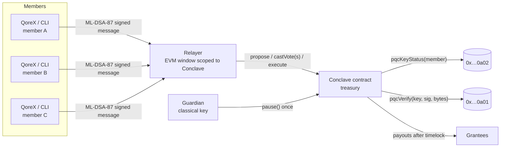
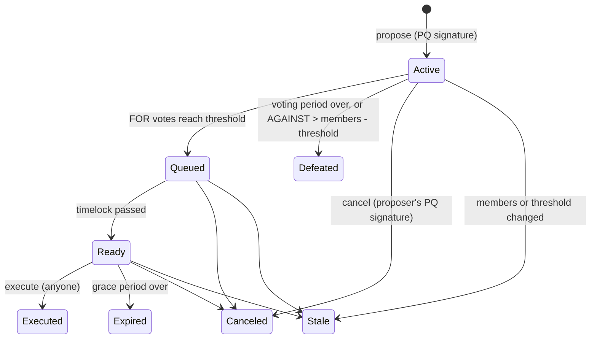

# Conclave architecture

## Components



- **Members** hold a classical key and an ML-DSA-87 key, both derived from the same recovery
  phrase by QoreX. Their ML-DSA-87 public key is registered on chain, with proof of possession.
- **Conclave** holds the treasury (native QOR and ERC-20 such as fUSD). It never trusts
  `msg.sender` except for the guardian's one-shot pause.
- **The relayer** pays gas. It needs its own registered key and a live EVM window; Conclave scopes
  that window to its own address (`allowedTargets = [Conclave]`). Anyone can relay, so a relayer
  that refuses to cooperate is replaced, not obeyed.

## Proposal life cycle



`state()` is computed, never stored: only `executed`, `canceled`, `eta` and the vote counts are
written. A proposal is **Stale** when the DAO's `epoch` moved on after it was created; every member
or threshold change advances the epoch, so votes counted under an old membership never execute.

## Signed messages

Members sign plain text. QoreX shows all of it before approving. The ML-DSA-87 key signs
`"qorechain-msg-v1|" + nativeChainId + "|" + message` (QoreSign `messagePqSignBytes`), and the
contract rebuilds exactly those bytes before calling `pqcVerify`.

```text
Conclave v1                       Conclave v1                    Conclave v1
action: propose                   action: vote                   action: cancel
proposal hash: 0x<32 bytes>       support: for | against         proposal: <id>
nonce: <member's propose nonce>   proposal: <id>                 proposal hash: 0x<32 bytes>
valid until: <unix time>          proposal hash: 0x<32 bytes>    member: 0x<20 bytes>
member: 0x<20 bytes>              member: 0x<20 bytes>           dao: 0x<20 bytes>
dao: 0x<20 bytes>                 dao: 0x<20 bytes>              chain: 9800
chain: 9800                       chain: 9800
```

| Field | Prevents |
|---|---|
| `action` | A signature for one action being used for another |
| `support` | Turning a vote FOR into AGAINST or back |
| `proposal`, `proposal hash` | Reusing a vote on another proposal; the hash also shows exactly what is voted on |
| `nonce`, `valid until` | Replaying a propose signature, or holding one back for later |
| `member` | Counting one member's signature as another's, even if both registered the same key |
| `dao` | Replay on another Conclave deployment |
| `chain` + native chain id prefix | Replay on another network (EVM chain id and native chain id both bound) |

Values are decimal integers or lowercase hex; neither can contain a newline, so the encoding is
unambiguous. The native chain id is checked against QoreSign's rule (`^[A-Za-z0-9._-]+$`) at
deployment, so it cannot contain `|`. The views `proposeMessage`, `voteMessage`, `cancelMessage`
and `signingBytes` return the exact text and bytes, so wallets and frontends never rebuild them.

`proposalHash = keccak256(abi.encode(targets, values, calldatas, keccak256(description)))`.

## Execution

- Up to 16 actions per proposal, all executed or none (any failure reverts the whole call).
- Revert data is bubbled up; on success return data is **not** copied (no return-data bomb).
- Calldata sent to an address without code reverts (`TargetNotContract`) instead of silently
  succeeding.
- ERC-20 payouts go through `payERC20` (a self-call using `SafeERC20`), so a token that returns
  `false` cannot fake a successful payout.
- `execute` holds a re-entrancy guard; `propose`, `castVote(s)`, `cancel` and `pause` share it, so
  nothing in Conclave can change while a proposal executes except its own governance calls.

## Governance and configuration

Governance functions (`addMember`, `removeMember`, `setThreshold`, `setGuardian`, `unpause`,
`payERC20`) revert unless `msg.sender` is Conclave itself, i.e. inside an executed proposal.

Invariants, checked at deployment and **after all actions** of a proposal that changed them (so the
order of actions inside one proposal does not matter):

- 1 ≤ members ≤ 64, every member has an ML-DSA-87 key when added;
- 1 ≤ threshold ≤ members and `2 × threshold > members` (strict majority).

## Pause

The guardian may call `pause()` once. It blocks payouts for `pauseDuration` and disarms the
guardian until governance re-arms it with `setGuardian`. While paused, only governance actions on
Conclave itself, without value, can execute (`unpause`, `setGuardian`, `addMember`, `removeMember`,
`setThreshold`), so members can remove a compromised member or rotate the guardian. Deployment
enforces `pauseDuration < gracePeriod`, so a pause can delay a queued payout but never expire it.

## Upgrades

Conclave is an implementation behind `ConclaveProxy`, an unmodified OpenZeppelin 5.7
`TransparentUpgradeableProxy`. The proxy address is the DAO: it holds the treasury and all state,
and it is what members sign for (`dao:` in every message), so signatures and history survive an
upgrade.

- **No upgrade key.** The proxy creates a `ProxyAdmin` whose owner is the proxy itself (its address
  is predicted from the deployer's nonce, which the deploy pins). Upgrading means calling
  `ProxyAdmin.upgradeAndCall` from Conclave, which only an executed proposal can do: the same
  post-quantum quorum and timelock as a payout. `upgradesGovernedByDao()` checks this on chain; the
  deploy scripts and the app check it too.
- **Blocked while paused.** The ProxyAdmin is not Conclave, so an upgrade is not one of the
  governance actions allowed during a pause. The pause cannot outlast the grace period, so a queued
  upgrade can still run after it.
- **Atomic initialization.** The proxy is created with the `initialize` call in the same
  transaction (OZ 5.7 refuses a proxy without init data), so it cannot be initialized by someone
  else first. The implementation's constructor calls `_disableInitializers()`.
- **Freeze.** A proposal calling `ProxyAdmin.renounceOwnership()` makes the code permanent.

## Storage and gas

All state lives in one ERC-7201 namespace, `conclave.storage.Conclave`
(slot `0xcf22…6d00`), so a new version can append fields without collisions, and inherited
contracts (`Initializable`, `ReentrancyGuard`) keep their own namespaces.

| Slot (from the namespace) | Content |
|---|---|
| +0 | `votingPeriod` · `timelockDelay` · `gracePeriod` · `pauseDuration` (8 bytes each) |
| +1 | `nativeChainId` (ShortString) |
| +2 | `guardian` (20) · `guardianArmed` (1) · `pausedUntil` (8) · `threshold` (2) |
| +3 | `epoch` (4) · `proposalCount` (8) |
| +4 … +8 | `members`, `memberPosition`, `proposeNonce`, `proposals`, `hasVoted` |
| per proposal ×3 | `proposalHash` · `proposer`, `voteEnd`, `epoch` · `eta`, vote counts, flags |

`test_StorageLayoutIsNamespaced` pins this layout, so a change that moves a field fails the tests.

- Actions are not stored, only committed to by `proposalHash` and published in `ProposalCreated`.
- Public keys (2,592 bytes = 81 slots) are never stored: they are read from `pqcKeyStatus` on
  every check, which also makes key rotation and revocation take effect immediately.
- Timing lives in one packed slot (it was immutables before the proxy); errors are custom errors.
- Compiled with solc 0.8.28, `via_ir`, optimizer 1,000 runs, Cancun target. Runtime size 17.5 KB
  (implementation) and 1.0 KB (proxy).

Measured costs: `castVote` ≈ 146k gas of contract logic; the live `pqcVerify` precompile adds
≈ 185k and the 4,627-byte signature ≈ 74k of calldata, about 400k gas in total. The proxy adds
about 8–10k per call (a `DELEGATECALL` and the slots that were immutables).

## Deployment

`forge script` simulates deployments in Foundry's local EVM, which has no QoreChain precompiles,
so the member key checks in `initialize` would fail. [`scripts/deploy.ts`](../contracts/scripts/deploy.ts)
and the testnet bootstrap (`server/src/setup.ts`) check every member's key with `pqcKeyStatus`,
the threshold and the deployer's window, then send two transactions: the implementation, then the
proxy with `initialize`, and verify on chain that the ProxyAdmin is owned by Conclave. Testnet
only: the PQC precompiles are not active on mainnet yet.

## Design decisions

| Decision | Why | Alternative considered |
|---|---|---|
| Transparent proxy whose ProxyAdmin is owned by the DAO | Fixes and features can ship at the same address without giving anyone an upgrade key: an upgrade needs the same PQ quorum and timelock as a payout | Immutable contract (no fixes); UUPS (upgrade logic in the implementation, a bad upgrade can brick it); an EOA or multisig ProxyAdmin owner (a classical key that could swap the code on Q-Day) |
| Key from `pqcKeyStatus`, never from calldata | A signature can only count for the account that registered the key | Caller-supplied key: anyone could sign with their own key |
| Signer address inside every message | Two accounts may register the same (non address-bound) key | Rely on the key only |
| Relayed signatures, `msg.sender` ignored | On Q-Day a classical key may still use an open window | `msg.sender == member`: broken by a leaked ECDSA key |
| Strict-majority threshold | Two disjoint groups can never both pass proposals | Any threshold |
| Epoch-based staleness | Votes counted under an old membership never execute | Re-count votes (needs iteration) |
| One-shot guardian fuse, pause < grace | A stolen guardian key can delay once, not hold the DAO hostage | Unlimited pause; no pause at all |
| Human-readable messages | Members see what they sign in QoreX, even behind a malicious frontend | Sign an opaque hash |
| Governance selectors allowed while paused | Members can fix the cause of a pause | Freeze everything |
